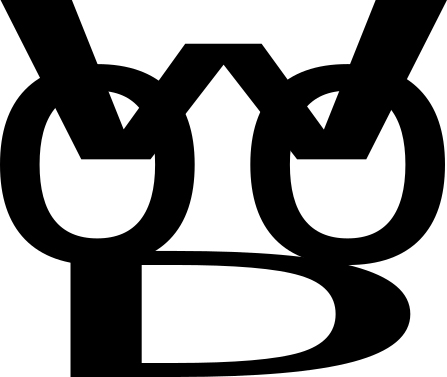

# Hust

Hust 是面向 Rust 与 C 的源到源转译语言。当前仓库包含指导器和两个独立语言核。

## 核心版本

| 核心 | 产物 | 版本 |
|------|------|------|
| Conductor | `hustc` | 0.1.1.20261127083800 |
| Rust 语言核 | `hust_rust` | 0.3.12.20261127083900 |
| C 语言核 | `hust_c` | 0.1.1.20261127084000 |
| C# 语言核 | `hust_csharp` | 0.1.1.20261127083700 |

## 仓库布局

| 目录 | 产物 | 角色 |
|------|------|------|
| `Conductor/` | `hustc` | 指导器：读取配置、发现核、选核、编排构建与运行 |
| `Hust-Rust/` | `hust_rust` | Rust 语言核 |
| `Hust-C/` | `hust_c` | C 语言核 |
| `tests/` | - | 跨核集成与全量回归入口 |

一个项目只使用一个语言核，不支持混核。

## 快速开始

### 一体式构建安装（推荐）

```bash
./install.sh
hustc --cores
```

安装到 `~/.local/bin/`：
- `hustc` - Conductor CLI
- `hust_work/hust_core/hust_c/` - C 核心（含 include/ 和 lib/）
- `hust_work/hust_core/hust_rust/` - Rust 核心（含 include/ 和 lib/）

### 单独构建各部件

```bash
# Conductor
cd Conductor && cargo build --release

# Rust 核心
cd Hust-Rust && cargo build --release

# C 核心
cd Hust-C && make
```

详见各部件的 README.md：
- `Conductor/README.md`
- `Hust-Rust/howto_build.md`
- `Hust-C/README.md`

### 常用命令

```bash
hustc run main.hust                 # 单文件运行（默认 Rust 核）
hustc run myproj --core-c           # 项目运行（显式 C 核）
hustc build myproj -o bin/app       # 构建产物
hustc check myproj --core-rust      # 只转译，不调用目标编译器
hustc --cores                       # 列出可用核与工具链
```

模式默认值：`run` 使用 debug，`build` 使用 release；`--debug` / `--release` 覆盖。

旧脚本只需把 `hust` 改成 `hustc`。源码、`settings.config` 和项目目录结构不变。

## 测试

```bash
./tests/run_all.sh                  # Conductor + 两核 + P3
./tests/run_all.sh --with-install   # 加安装端到端
./tests/run_all.sh --strict         # Hust-Rust 已知问题也判失败
```

单独运行：

```bash
cd Hust-Rust && ./tests/run_tests.sh
cd Hust-C   && ./tests/run_tests.sh
cd Hust-C   && ./tests/run_tests.sh negative
```

完整测试方法与基线见 `../Hust-Docs/doc/core_testing_guide.md`。

## 文档

- `../Hust-Docs/doc/develop_guide.md`：开发指引
- `../Hust-Docs/doc/core_development_playbook.md`：新语言核开发与 Conductor 接入
- `../Hust-Docs/doc/core_testing_guide.md`：语言核测试指引
- `../Hust-Docs/doc/conductor_multicore_design.md`：Conductor 多核设计

## 开源许可 / License

本项目采用 MIT 协议，可自由使用、修改、分发。

This project is licensed under the MIT License, can be freely used, modified, and distributed.

## 贡献 / Contributing

欢迎提交 Issue 或 Pull Request 改进此框架。

Welcome to submit Issues or Pull Requests to improve this framework.

<p align="center">
  <br>
  <em>开源免费 • MIT 协议 / Open source • MIT License<br>Wood logo 是 Wood 项目的标识 / Wood logo is the trademark of Wood projects</em>
</p>
